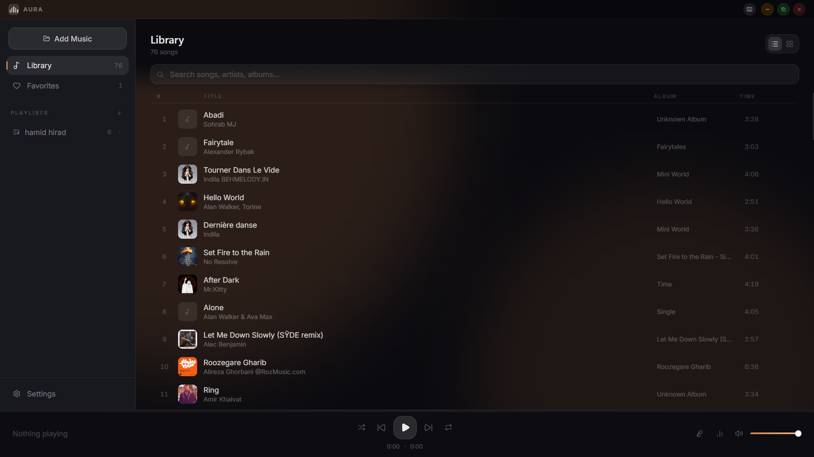
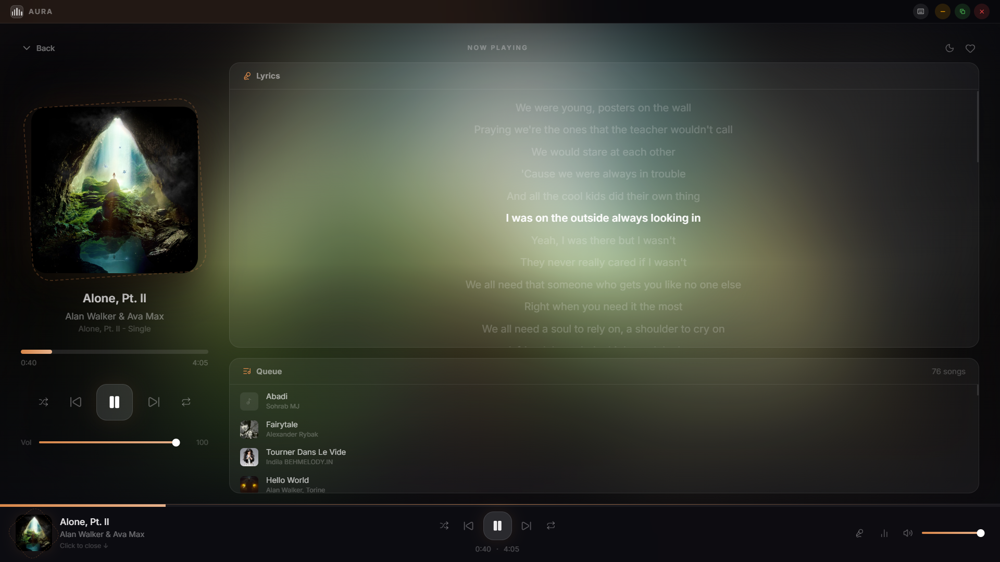
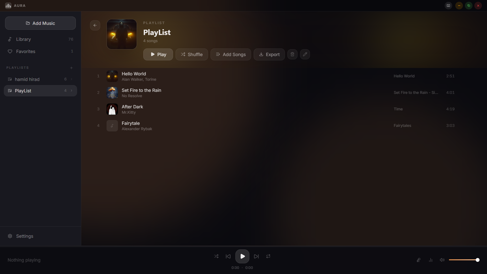
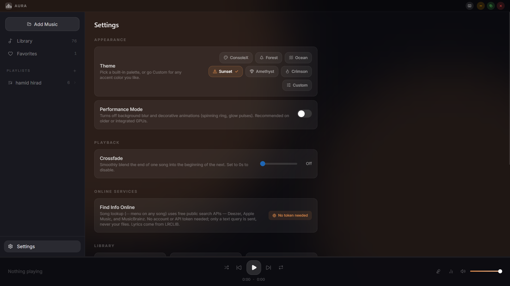
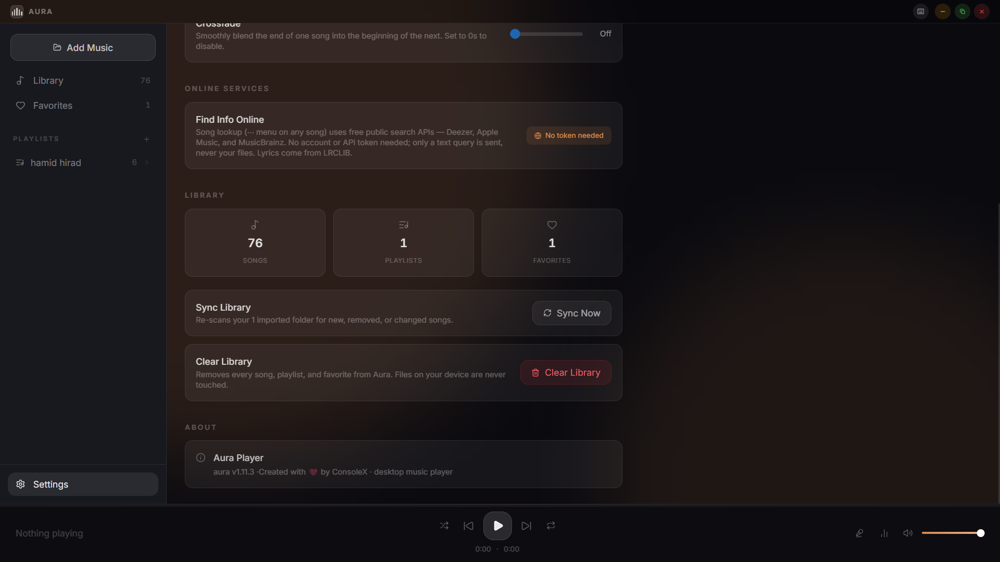

# 🎵 Aura Player

> A desktop music player built with Tauri, Rust, React, TypeScript, and Vite.


---

## ✨ Overview

Aura Player is a local-first desktop music player focused on performance, thoughtful interaction, and a distinctive visual experience.

Its interface combines layered materials, carefully tuned motion, and artwork-aware color to make the listening experience feel cohesive without getting in the way of the music.

v3 is the liquid-glass generation. A wide glass play bar breathes with the real bass of the track, eight complete theme identities each carry their own light paper and secondary accent, the sidebar truly collapses, the Now Playing view became a stage that crossfades between synchronized lyrics and three live visualizers, and the audio engine gained an effects rack with importable presets. Your music got more personal too — custom cover art, searchable track notes, and a first launch that greets you by name. Online, Explore reads as an editorial discovery page, Radio is filtered to music, and every failure state still tells you the truth.

---

## 🚀 Features

### 🎵 Music Library

- Import an entire music folder
- Import individual songs, one or many at once
- Folder Sync — re-scan imported folders for new, removed, or changed songs
- **Folder Watching** — imported folders are monitored for changes; the library reconciles itself automatically, and the feature can be toggled in Settings
- **Library Sorting** — Recently Added, Title, Artist, Album, or Duration, each with ascending/descending order
- **Album Grid View** and fast virtualized List View
- Automatic metadata detection
- Album artwork support (embedded art cached to disk — large libraries stay light)
- **Custom cover art** — override any song's artwork with your own image from the Properties page; it is scaled to a bounded local copy (≤512px), your audio files and provider metadata are never touched, and the override shows up everywhere — play bar, Now Playing, song rows, even the Mini Player — with a one-click reset to the original
- **Track Notes** — private notes on any song, autosaved locally as you type, and searchable from the library search (free text or the dedicated `note:` operator)
- Search across songs, artists, albums, and your notes
- "Show in Folder" — reveal any song's file in Explorer

### ❤️ Favorites

- Mark songs as favorites
- Dedicated favorites page

### 📂 Playlists

- Create playlists
- Rename playlists
- Delete playlists
- Add songs individually, or many at once via "Add Songs"
- Remove songs
- Remove from queue (Now Playing view)
- Export as M3U — opens in VLC, Winamp, and most other media players
- **Searchable "Add to Playlist" picker** — stays the same size whether you have 3 or 300 playlists

### 🏷 Song Properties

- "Properties" on any song's ⋯ menu — a full Windows-Media-Player-style page: tag details (title, artist, album, year, genre, track) plus technical file info: format, codec, size, bitrate, sample rate, channels, and full file path
- "Your Listening" — per-song plays, completions, skips, total time, last played (100% local)
- **Artwork & Notes tab** — choose, replace, or reset custom cover art with a live preview and an "Override active" badge, plus the Track Note editor with debounced autosave
- "Show in Folder" shortcut right from the page

### 🔍 Find Info Online (keyless)

- Find the correct info for songs whose tags are wrong or missing — "Find Info Online" in the ⋯ menu, or from the Properties page
- Searches **three free music databases at once — Deezer, Apple Music (iTunes), and MusicBrainz** — and merges the results into one ranked candidate list with source badges and a BEST match marker
- **No API key, no account, no audio upload** — only a plain text query ("artist + title") is sent; your files never leave the device
- Search fires automatically when the tab opens, and the title/artist fields are editable for instant retries
- Aura shows a before → after diff of the found title, artist, album, year, and genre — you tick exactly what to apply, and nothing else
- Found album art can be applied too; it's cached locally like embedded covers, so it keeps working offline

### 🎼 Lyrics

- Automatic synchronized lyrics in the Now Playing view and a Lyrics popover on the play bar
- Powered by LRCLIB
- Fallback when lyrics aren't available

### 📊 Aura Rewind

- Your month, told by your own listening — a cinematic stats story computed from the 100% offline scrobble store
- Total listening time, top songs / artists / albums with animated rankings, a 24-hour listening clock, week rhythm, a day-by-day heatmap, completion donut, streaks, and unique counts
- Month stepper to travel back through your history
- Render a shareable 1200×630 image card locally — nothing is uploaded anywhere

### 🎧 Playback

- Play / Pause
- Previous / Next
- Shuffle — a real play order (the queue always shows exactly what plays next)
- Repeat (all / one)
- Crossfade — smooth fade between songs, adjustable 0–12s
- **10-band Equalizer** — 10 preset curves plus fully custom band control and user-saved curves, persisted; flat = true bypass — now living in the dedicated **Audio Studio** (see below)
- **Audio Studio** — a dedicated Sidebar destination for all sound shaping: Master (preamp, balance, limiter), Equalizer, Effects, Presets, and a global Bypass — see below
- Sleep Timer — auto-pause after 15/30/45/60 minutes (Now Playing view)
- Volume Control + scroll-wheel fine adjustment
- Seek bar with hover time labels
- **The queue survives restarts** — it persists as ID references, rebuilds against your library at launch, and Aura never autoplays on startup
- **Aura Pulse** — the play bar's aurora field breathes with the track's real low-frequency energy; rests smoothly on pause, and freezes in Performance Mode

### 🎛 Audio Studio (v3.2.0)

A dedicated workspace for everything that shapes the sound, reachable from the Sidebar (or Ctrl+K → "Open Audio Studio"). It edits the same live playback graph the main player, Playbar and Mini Player use — there is exactly one audio engine, and the Studio is a control surface over it, never a second one.

- **Master** — input **Preamp** (−12…+12 dB with a 0 dB reference tick), stereo **Balance** (double-click or press 0 to recenter), and an honest **Output Limiter** protection stage that catches peaks a boosted EQ or preamp would clip
- **Equalizer** — the 10-band graphic EQ (31 Hz – 16 kHz) with drag, double-click reset and arrow-key nudging; 10 built-in curves (Flat, Bass Boost, Vocal, Treble, Pop, Rock, Jazz, Electronic, Classical, Acoustic); an **Enable gate** that flattens the bands while keeping your curve intact; **custom curves** with save / rename / duplicate / delete
- **Effects** — the five real controls (Bass, Treble, Compression, Reverb, Stereo Width) on the Web Audio chain, built-in presets, and **custom effect presets** with full rename/duplicate/delete support; export/import as JSON configuration (never processed audio)
- **Bypass & Reset** — one toggle suspends the whole chain (every stage glides to its transparent neutral point; your settings are kept), one button resets everything
- A live status pill tells you what the engine is actually doing: Neutral, Active (N stages), or Bypassed
- **Zero-cost architecture** — every stage sits at an acoustically transparent neutral value until you touch it; parameter changes glide through scheduled AudioParam updates; the graph is built once and never rebuilt

### 🪟 Desktop Integration

- **System Media Controls** — supported desktop environments can expose the current track and playback controls through their native media interface.
- Global media keys — supported playback shortcuts work even when Aura isn't focused.
- Native window integration for playback controls where supported by the operating system.
- File associations can be registered through the platform's installer and operating-system settings.
- Single-instance behavior routes supported file-open requests to the running application.

### 🐧 Linux

- **AppImage and .deb** packages built from the repository (`npm run build:linux`)
- Audio file associations via the desktop entry — Aura shows up in your system's "Open with" list
- The same full app: liquid-glass UI, themes, effects, Mini Player, and first-launch flow all behave natively on Linux

### 🌐 Explore & Radio

- **Explore 3.0** — an editorial discovery page over Audius: a #1 hero card with Play-now, ranked trending rails, an "Under the Radar" grid, large online-playlist cards, and Fresh Finds — every piece plays straight into the same engine, queue, and Mini Player as your local files
- **Live Radio** (Radio Browser) — search by name, filter by country, language, or genre, ranked by community votes
- **Radio stays about the music** — stations tagged news, talk, politics, religion, sports, and similar are filtered out by their own metadata; untagged stations are kept (no evidence, no assumption), and your radio favorites are never filtered
- **Failure states that speak** — Aura distinguishes "your internet connection is down" from "this online service is currently unavailable"; timeouts, rate limits, and provider errors each get their own message and a Retry
- Offline, Explore stays useful with direct jumps into your local Library and Favorites

### ⌨ Keyboard Shortcuts

Open the in-app cheat sheet anytime with the **keyboard icon** in the title bar, or by pressing **?** — no need to memorize anything.

| Key | Action |
|------|--------|
| Space | Play / Pause |
| ← | Previous Song |
| → | Next Song |
| Ctrl + ← | Seek Back 5s |
| Ctrl + → | Seek Forward 5s |
| ↑ | Volume Up |
| ↓ | Volume Down |
| L | Toggle Favorite |
| S | Toggle Shuffle |
| R | Cycle Repeat |
| M | Mute / Unmute |
| Ctrl + K | Command Palette |
| N | Toggle Now Playing |
| Q | Queue Panel |
| P | Mini Player |
| ? | Keyboard Shortcuts Guide |
| Esc | Close Panels & Dialogs |
| Scroll | Adjust Volume (over the volume control) |

### ⌘ Command Palette (Ctrl+K)

- The whole app, one keystroke away: navigation, playback actions, playlist jumps, panel toggles, and system switches (theme, mini player, Performance Mode)
- Live library search — find a song and press Enter to play it
- Fuzzy matching with ranked results, full keyboard navigation

### 💬 Instant Feedback (Toasts)

Every keyboard action gives visible confirmation — a small toast rises above the player bar:

- ❤️ "Added to Favorites" — with the song's title and artist, so pressing L deep in a scrolled list is never a guess
- 🔀 Shuffle on/off · 🔁 Repeat mode changes · 🔇 Mute/unmute
- ▶️ "Now Playing" card when skipping with ←/→
- 🌙 "Sleep Timer Ended" when the timer fires
- 📚 "Library synced" when Folder Watching picks up changes
- Volume changes show a compact **% pill** right above the volume slider (works for keys, scroll wheel, mute — everything)

### 🎨 UI

- **Twelve theme identities** — ConsoleX, Ocean Deep, Amethyst, Cyan Frost, Emerald, Crimson, Amber, Mono, plus the v3.2.0 Specials **Orchid, Indigo, Champagne and Aurora** — each remapping the entire palette (ink scale, ambient clouds, and a curated secondary accent) and carrying its own light "paper" for light mode; a fully Custom accent color is still available; every switch crossfades
- **Liquid-glass play bar** — a wide glass slab (no more pill) with a top sheen, an accent-tinted hairline border, and a two-layer aurora field that breathes with the track's real bass; still when paused, calm in Performance Mode and reduced-motion
- **Collapsible sidebar** — the floating glass card folds from 246px to a 56px icon rail and back, remembers its state across restarts, and keeps every destination reachable; v3.2.0 gives it a designed collapse chip, a travelling selection pill across all destination rows, and coordinated label fades (all reduced-motion aware)
- **Now Playing stage** — one quiet segmented toggle crossfades between synchronized **Lyrics** and a full-size **Visualizer** (Aurora, Particles, or Radial) on a single efficient canvas that only animates while music plays
- **Mini Player 3.2** — the independent desktop widget now adds a real **seek bar** with elapsed/remaining times, a **volume slider with mute**, keyboard-focusable transport buttons, and inherits your theme, accent, and adaptive on-accent ink; keeps its full draggable, always-on-top lifecycle and position memory
- **A first launch that greets you** — an optional display name (never an account, never sent anywhere), a time-of-day "welcome back" greeting in the Library, and an honest "make Aura your default player" offer that opens your OS settings — no registry hacks, no fake success
- **Dark & Light themes** — dark is Aura's true form; light is a designed, glow-first paper look with an animated cross-fade between them
- Dynamic Accent Colors: your chosen theme stays consistent everywhere, except the Now Playing view, which pulls its ambient color from the current song's actual album art
- Living Background: soft ambient light behind the interface, following the active theme (frozen automatically in Performance Mode)
- Glassmorphism with depth — layered translucency, soft shadows, refined hover and press states everywhere (never a layout shift)
- Smooth animations — transform/opacity only, GPU-friendly, all of it disabled under Performance Mode or reduced-motion
- Keyboard focus indicators throughout — fully navigable without a mouse

### ⚡ Desktop

- Native Tauri desktop application
- Drag-and-drop import — drop audio files or whole folders anywhere on the window
- Fast startup — lazy-loaded pages, virtualized lists, IndexedDB-backed library
- Local music playback
- Persistent settings, library, queue, and last-played state
- **Performance Mode** — one toggle strips blur and decorative animation for weak GPUs

---

# 🛠 Tech Stack

### Desktop

- **Tauri 2**
- **Rust**

### Frontend

- React
- TypeScript
- Vite
- Tailwind CSS v4
- Zustand
- Framer Motion
- Lucide Icons

### Audio & Data

- Web Audio API
- `music-metadata`
- LRCLIB for synchronized lyrics
- Deezer, Apple Music, and MusicBrainz for metadata lookup
- Audius for online music discovery
- Radio Browser for internet radio

---

# 📦 Development & Build

## Requirements

- Node.js and npm
- Rust toolchain
- Tauri's platform-specific prerequisites for your operating system

See the [Tauri prerequisites guide](https://v2.tauri.app/start/prerequisites/) before building.

## Get the source

```bash
git clone https://github.com/ConsoleX-ir/Aura-player.git
cd Aura-player
npm install
```

## Run in development

```bash
npx tauri dev
```

## Build

```bash
npx tauri build
```

Tauri creates native release bundles for the targets enabled in the project's Tauri configuration. Build on the target operating system and consult the generated bundle directory for the resulting installer or package.

# 📁 Project Structure

Aura is organized into a web frontend and a native Tauri application layer.

```text
src/
 ├── components/   # Player, Library, Studio, Now Playing, Explore, Settings, and shared UI
 ├── hooks/        # Frontend hooks for playback, library, lyrics, and application state
 ├── pages/        # Main application views
 ├── store/        # Zustand stores and persisted application state
 ├── styles/       # Design tokens, themes, and global styles
 ├── types/        # Shared TypeScript types and native API contracts
 └── lib/          # Playback, queue, search, audio effects, recommendations, and statistics

src-tauri/
 ├── src/          # Rust application code and native commands
 ├── capabilities/ # Tauri permissions and capability definitions
 ├── icons/       # Application icons
 └── tauri.conf.json
```

The Rust layer handles native desktop integration and privileged operating-system operations. The React frontend communicates with it through Tauri's application API rather than an Electron main/preload process.

---

# 📸 Screenshots







---

# 🤝 Contributing

Contributions, ideas, and bug reports are always welcome.

Feel free to open an Issue or submit a Pull Request.

1.Arsalan Jafarnezhad : tester and feature suggester. Github: https://github.com/Arsalan-Jafarnezhad

---

# 📄 License

This project is licensed under the MIT License.

---

# 👨‍💻 Author

**ConsoleX**

Built with care by ConsoleX.
